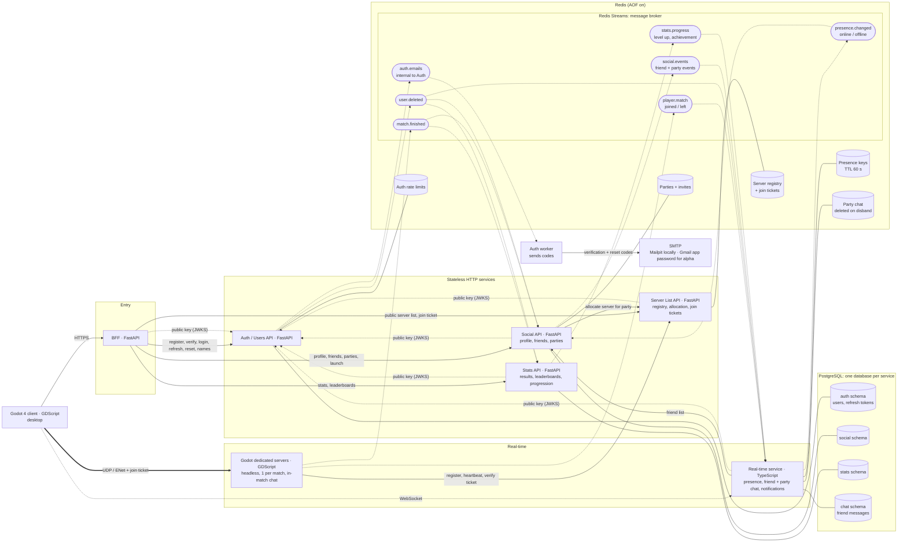

# Project context: multiplayer FFA shooter (Godot 4 + microservices)

This summarizes design decisions made in a previous conversation. Use it as the starting point: the decisions below are settled unless listed under "Open questions".

## The game

- **Third-person free-for-all multiplayer shooter**.
- Built with **Godot 4**, scripted in **GDScript**. There are several development machines, running **Debian** and **Windows 11**.
- **Desktop client first.** A web (browser) version may come later as a second version; ignore it for now.
- Backend built as **microservices**. Part of the goal is to learn microservices, but the split follows real technical boundaries (connection type, load, failure isolation, data ownership).
- Players form a **party (lobby) of up to 8** before playing. **Launching from a party always creates a new match** on a fresh server. Once the match has started, **strangers can join it** from the public server list.
- **A match holds at most 8 players** (`max_players = 8`), the same as a party. Strangers can only join a match whose party had fewer than 8 members, or after players leave.

### Explicitly out of scope for now
- Matchmaking (replaced by party-launched matches + public server list)
- Anti-cheat
- Telemetry / analytics
- Web/browser client

## Starting point

- **Everything is built from scratch**, including the Auth / Users API (a previous one no longer exists). No existing users to migrate.
- The user's **`user_id`** (UUID, primary key of the users table in the `auth` schema) is the link to all game data. Every other store references players by this ID. There are no cross-schema foreign keys, so consistency is handled in code (lazy player creation, `user.deleted` event).

## Architecture

### Services

| Service | Responsibility | Data |
|---|---|---|
| **Godot 4 client** (desktop, GDScript) | The game. HTTPS to the BFF for menus, WebSocket to the real-time service, UDP/ENet to game servers. | — |
| **BFF** | Single HTTPS entry point for the client. Forwards the player's JWT to the services and merges data (e.g. scores + player names). | — |
| **Auth / Users API** | Registration, email verification, login, JWT issuing and refresh, password reset, account deletion, batch name lookup (`GET /users?ids=`), JWKS endpoint. Sends emails through a worker process. | PostgreSQL `auth` schema + Redis (rate limits) |
| **Server List API** | Registry of running game servers, public server list, server allocation for parties, join tickets. | Redis |
| **Social API** | Profiles, friends, parties, invites, party launch. | PostgreSQL `social` schema + Redis (parties, invites) |
| **Stats API** | Match results, leaderboards, progression (XP, levels, achievements). | PostgreSQL `stats` schema |
| **Real-time service** | One WebSocket per online player: presence, friend messages, party chat, notifications pushed to clients. | Redis (presence, party chat, `realtime:*`) + PostgreSQL database `realtime`, schema `chat` (friend messages) |
| **Godot dedicated servers** (GDScript) | Same Godot project exported for Linux, run `--headless`. One match per instance, server-authoritative (clients send inputs). ENet over UDP. Also relays in-match chat. | In memory |

### Infrastructure
- **PostgreSQL**: **one database per service** (`auth`, `social`, `stats`, `chat`), each with its own user; in development each runs in the service's own Postgres container. Inside its database a service keeps its tables in a schema of the same name (created by its first migration). A service can move to another server by changing its `DATABASE_URL`.
- **Redis**: one shared instance used for the server registry, join tickets, presence keys, parties/invites, party chat, and **Redis Streams as the message broker**. **AOF persistence must be on** (stream messages must survive a restart).
  - **Every key starts with its owning service** (`auth:`, `serverlist:`, `social:`, `stats:`, `realtime:`); only the stream names (`user.deleted`, `social.events`, …) are shared.
  - **One ACL user per service** (`infra/redis/start.sh`), limited to its own prefix, read/write on the streams it consumes (consumer groups record acknowledgements) and write-only on the streams it only publishes; Pub/Sub only on its own channels (`&realtime:*` for Real-time); `-@dangerous` (no `FLUSHDB`, `KEYS`, `CONFIG`, `INFO`…, so clients must not rely on `INFO`, e.g. ioredis' ready check is off). Each service's `REDIS_URL` carries its user and password.
  - The `default` user is the admin, behind a password, and **must keep full rights**: Redis replays the AOF at startup as the default user and silently drops any `MULTI`/`EXEC` (which includes Lua script results) it isn't allowed to run.
  - Services' Redis clients reconnect and retry on connection errors, so a Redis restart doesn't fail requests.
- **Email sending** goes through plain **SMTP** configured by environment variables (`SMTP_HOST`, `SMTP_PORT`, `SMTP_USER`, `SMTP_PASSWORD`, `SMTP_FROM`), so changing provider is a configuration change only:
  - **Local development**: **Mailpit** in Docker Compose catches all outgoing emails in a web inbox.
  - **Testing with real inboxes and the small alpha (current choice)**: a **dedicated Gmail account** (not a personal one) with 2-Step Verification and an **app password**, sending through `smtp.gmail.com:587` with STARTTLS. Limits: 500 emails/day; exceeding it can block sending for up to 24 h; changing the account password revokes the app password.
  - **Before the public release**: own domain (e.g. `no-reply@yourgame.com`) with a transactional provider (Brevo or Scaleway TEM preferred, EU-based) and SPF, DKIM and DMARC records. Never send from a Gmail address through a third-party provider (fails DMARC).
- Local dev: Docker Compose, headless Godot server locally, several game clients on one machine.
  - **Each service runs alone** from its folder: `docker compose --profile standalone up --build` starts it with its own Postgres and its own Redis (`services/<name>/compose.yaml`, `.env.example`, `README.md`).
  - **The full stack** is the root `docker-compose.yml`, which `include:`s every service's `compose.yaml` plus `infra/compose.yaml` (the shared Redis with ACLs) and small `infra/fullstack/*.yaml` overrides (wait for the shared Redis). Variables come from the root `.env`.
  - **Tests** start their own throwaway Postgres/Redis containers with testcontainers (`uv run pytest` in a service folder, Docker running); they never touch development data.
  - Auth's JWT signing key lives in `services/auth/keys/` (git-ignored), created by `services/auth/scripts/gen_keys.py`.
- **Cross-platform development (Debian and Windows 11)**: Docker Desktop with the WSL 2 backend on Windows, native Docker on Debian, same `docker-compose.yml` on both. Keep the repository working on both systems: a `.gitattributes` forcing LF line endings (shell scripts and Dockerfiles break with CRLF), no OS-specific paths, and helper scripts that run in both environments (e.g. Python scripts or a Makefile used from WSL). The headless game server can be exported for Linux from either OS; on Windows it can run in Docker or WSL.

### Tech stack

| Service | Language / framework | Main libraries |
|---|---|---|
| Auth / Users API | Python, **FastAPI** | SQLAlchemy async or asyncpg, Alembic, a password hasher using Argon2 (`argon2-cffi` or `pwdlib`), PyJWT (signing), `redis-py` (publishing `user.deleted`, `auth.emails`, rate limits), `aiosmtplib` (SMTP, provider-agnostic) |
| Server List API | Python, **FastAPI** | `redis-py` (asyncio), PyJWT + JWKS client |
| Social API | Python, **FastAPI** | SQLAlchemy async or asyncpg, Alembic, `redis-py` (Streams + Lua script for party joins), PyJWT |
| Stats API | Python, **FastAPI** | SQLAlchemy async or asyncpg, Alembic, `redis-py` (Streams, sorted sets for leaderboard cache), PyJWT |
| BFF | Python, **FastAPI** | `httpx` (async) to call the other services |
| Real-time service | **TypeScript (Node.js 24+)** | `ws`, `ioredis` (presence, party chat, Streams, Pub/Sub), `jose` (JWT/JWKS), `pg` with a small SQL migration runner (`migrations/*.sql`), `ajv` (event validation against the contract); tests with vitest + testcontainers |
| Godot client and dedicated server | **GDScript** | Godot high-level multiplayer, ENet, `HTTPRequest`, `WebSocketPeer` |

Why this split: the stateless services are ordinary request/response work, where FastAPI is quick to write, validates with Pydantic and generates OpenAPI docs. The real-time service holds thousands of long-lived WebSockets, which Node handles efficiently; it is the only service with a reason to use a different language.

Conventions:
- **Event formats have one source of truth**: Pydantic models in `tpsarena_common.events` → `python -m tpsarena_common.export_schemas` writes `libs/common/schemas/events.json` (committed; a test fails if it's out of date) → released with the package tag → Real-time copies it from a tag (`npm run sync:events -- X.Y.Z` → `contracts/events.json`) → `json-schema-to-typescript` generates its types before each build and test, and Ajv validates events at runtime against the same file. A format change then breaks the TypeScript build instead of silently breaking notifications.
- **Versioned shared package**: services depend on a **git tag** of `libs/common` (`common-vX.Y.Z`) from the private GitHub repo `ElianPICQ/TSArena_backend`, pinned to a commit by `uv.lock`. `scripts/release_common.py X.Y.Z` runs its tests, updates its version and CHANGELOG, tags and pushes; each service upgrades on its own (change the tag, `uv lock`). Images build from the service folder; the builder stage downloads the package through the developer's SSH agent (`ssh: [default]` in compose, `ssh-add` once per session) and the final image has no git or keys. `uv run --with-editable ../../libs/common pytest` tries an unreleased change.
- **Shared internal Python package** (`libs/common`, `tpsarena_common`) for the Python services: JWT verification (JWKS fetched once, cached, fetched again on an unknown `kid`), the Redis Streams consumer base (consumer groups, `XACK`, `XAUTOCLAIM`, duplicate skipping, undecodable messages logged and acknowledged), event models.
- **Stream entry format**: every entry has three fields: `event_id`, `type` (e.g. `party.updated`, picks the model) and `data` (the model's other fields as JSON).
- **Stream consumers run as a separate process** from the API: same codebase, different entry point (e.g. `python -m stats.worker`), so the API and the consumer restart and scale independently.
- **Async everywhere** in FastAPI: no blocking calls in async routes (use `httpx`, not `requests`; async DB drivers).
- Run FastAPI with **uvicorn**, one process per CPU core in production.
- JWT verification and the stream consumer loop also exist in TypeScript in the real-time service (`src/jwt.ts`, `src/streams.ts`); keep both implementations behaving the same (same error codes, same `{prefix}:handled:{group}:{event_id}` markers, undecodable events acknowledged). The TypeScript consumer already survives a lost Redis connection (see TODO.md for the Python one).

### Authentication
- Auth signs JWTs with an **asymmetric key** (RS256 or EdDSA) so other services can verify them with the public key only. The JWT contains the user ID in `sub` and is short-lived (around 15 minutes).
- **Refresh tokens** are long-lived, stored hashed in the `auth` schema, rotated on each use, and revoked on logout.
- Passwords are hashed with **Argon2**.
- Every service verifies JWTs locally using Auth's public key (**JWKS** endpoint), no call to Auth per request.
- The desktop client holds its tokens and sends the access token to the BFF, which forwards it to the services.
- Game servers authenticate to the Server List API with a **server secret** (env variable), not a player token.
- Players join a game server with a **single-use join ticket** (30 s TTL), verified by the game server through the Server List API (`GETDEL` so it can't be reused).

### Email verification and password reset
- Both use **6-digit codes typed in the game client**, not links, so no website is needed.
- Codes are random, **stored hashed** in the `auth` schema (`email_codes` table: user_id, purpose `verify` | `reset`, code_hash, expires_at, attempts, used_at), expire after **15 minutes**, allow **5 attempts**, and are single use. Requesting a new code invalidates the previous one.
- **Unverified users cannot log in.** `POST /login` with correct credentials but an unverified email returns `403` with error code `email_not_verified`; the client then shows the code entry screen. Because this error is only returned after a correct password, it does not reveal which emails are registered. Since every logged-in user is verified, no `email_verified` claim or check is needed in the JWT, the BFF or the other services.
- `POST /verify-email` and `POST /verify-email/resend` work **without being logged in** (they take the email address). Resend always gives the same answer, whether or not the account exists, and is rate limited.
- A successful `POST /verify-email` **returns the access and refresh tokens directly**, so the player doesn't have to type their password again.
- **Unverified accounts are deleted after 7 days** (periodic cleanup job in the Auth worker), so abandoned registrations don't hold onto email addresses or usernames.
- **Password reset** never reveals whether an email is registered: the request always answers "if an account exists, a code was sent". A successful reset **revokes all refresh tokens** of that user.
- **Sending is asynchronous**: the Auth API publishes to the internal `auth.emails` stream and an Auth worker process (`python -m auth.worker`) sends the email, so a slow email provider never slows down requests.
- **Rate limits** in Redis on code requests and attempts, per email and per IP.

## Chat

| Kind | Transport | Storage | Lifetime |
|---|---|---|---|
| **Friend to friend** | Real-time service (WebSocket) | PostgreSQL `realtime` database, `chat` schema | Persisted, **kept 90 days** (hourly cleanup, one instance at a time). Friends only, 1–500 characters, 10 messages per 10 s per connection. Delivered live, or when the friend comes online. History: `GET /conversations/{friendId}/messages`. Deleted on `user.deleted`. |
| **Party chat** | Real-time service (WebSocket) | Redis list `realtime:party_chat:{party_id}` (capped) | Deleted when the party is disbanded (`party.disbanded` event). |
| **In-match chat** | Game server (Godot RPC over ENet) | Game server memory only | Gone when the match ends. Never stored. |

The real-time service knows party membership from `party.updated` events (it keeps its own copy) and only lets members read and post in a party's chat. It does not read Social's Redis keys.

## Redis data structures

```
# Server registry (Server List API)
serverlist:server:{server_id}      hash    address, port, name, region, map, status, players, max_players, party_id, reserved_until, build_version, started_at   (TTL 15 s, refreshed by heartbeat)
serverlist:server:{server_id}:tickets  zset  unused ticket ids scored by expiry: each holds a slot; reserved_slots = unexpired entries (computed, not stored)
serverlist:servers:active          zset    server_id scored by last heartbeat time (stale entries filtered and cleaned)
serverlist:ticket:{ticket_id}      string  { user_id, server_id }   (TTL 30 s, single use)

# Rate limits (Auth API)
auth:ratelimit:{action}:{email_or_ip}   counter   INCR + EXPIRE window (e.g. 3 code emails per 15 min, 10 logins per minute)

# Server status lifecycle
idle → reserved (allocated to a party) → in_progress (visible in public list if slots free) → ending → idle

# Presence (Real-time service)
realtime:presence:last_seen           zset    user_id -> last heartbeat (ms); being in it = online (Lua: online/offline announced once)
realtime:presence:{user_id}:conns     zset    connection id -> last heartbeat: connections per user (TTL 60 s)
realtime:presence:{user_id}           hash    activity: menu | in_match   (TTL 60 s, refreshed by client heartbeat)

# Party chat (Real-time service)
realtime:party_chat:{party_id}           list    recent party messages, capped; deleted on party.disbanded
realtime:party_chat:{party_id}:members   set     copy of party membership, maintained from party.updated events
realtime:party_chat:{party_id}:version   string  version of the party.updated snapshot applied (older snapshots ignored)
realtime:deliver                         Pub/Sub channel: pushes between Real-time instances
realtime:cleanup:lock                    string  one instance per hour deletes old friend messages

# Leaderboards (Stats API): cache of PostgreSQL totals, rebuilt from PostgreSQL if lost
stats:leaderboard:{type}      zset    user_id scored by all-time total; type = xp | wins | kills (written with ZADD GT: totals only grow)
stats:leaderboards:built      string  marker: absent means the boards must be rebuilt

# Parties (Social API)
social:party:{party_id}            hash    leader_id, status (lobby | launching | in_match), created_at
social:party:{party_id}:members    set     up to 8 user_ids (full-check + add done atomically with a Lua script)
social:user:{user_id}:party        string  party_id (one party per player)
social:invite:{invite_id}          hash    party_id, from, to   (TTL 60 s)
```

## Redis Streams (events)

| Stream | Published by | Consumed by | Purpose |
|---|---|---|---|
| `match.finished` | Game server | Stats, Social | Save match, update leaderboards, award XP (Stats); party back to `lobby` (Social, using the event's `party_id`) |
| `player.match` (`user_id`, `server_id`, `action`: joined / left) | Game server | Real-time | Presence "in match" / "in menu" |
| `auth.emails` | Auth API | Auth worker | Send verification and password-reset emails (internal to Auth) |
| `user.deleted` | Auth | Social, Stats, Real-time | Delete or anonymize the player's data (Stats deletes totals and achievements and sets `user_id` to null in stored match results; Real-time deletes friend messages and closes sockets) |
| `social.events` | Social | Real-time | Friend requests, `party.invite_sent`, `party.updated`, `party.match_ready` (server address + per-member ticket), `party.disbanded` (delete party chat) |
| `stats.progress` | Stats | Real-time | Push level-up (`progress.level_up`) / achievement (`progress.achievement_unlocked`) notifications |
| `presence.changed` (online / offline) | Real-time | Social | Remove disconnected players from parties |

Rules:
- One **consumer group per consuming service** per stream; multiple instances of a service share the group.
- Consumers **`XACK`** after processing; crashed consumers' pending messages are reclaimed with `XAUTOCLAIM`.
- Delivery is **at least once**: every event carries an ID (e.g. `match_id`) and consumers ignore IDs already handled.
- Publish with **`MAXLEN ~`** to trim streams.
- Use streams for "this happened" notices. Use direct HTTPS when the caller needs an answer (ticket verification, server allocation, friend list lookup).

## Key flows

**Register and verify**: client → BFF → Auth `POST /register` creates the user (Argon2 hash, `email_verified_at` null) and queues a verification code email; no tokens are returned. The client shows the code entry screen. The player types the code → `POST /verify-email` → account verified and tokens returned → player is logged in. `POST /verify-email/resend` sends a new code.

**Login**: client → BFF → Auth `POST /login`.
- Verified account: returns a short-lived access JWT and a refresh token. Client opens a WebSocket to Real-time with the access token → marked online. Client refreshes the access token through `POST /refresh` before it expires.
- Unverified account (correct password): `403 email_not_verified` → client shows the code entry screen (with a "resend code" option).
- Wrong credentials: `401` with the same message whether the email exists or not.

**Password reset**: `POST /password-reset/request` with the email → always the same answer; a code is emailed if the account exists. `POST /password-reset/confirm` with email, code and new password → password changed, all refresh tokens revoked, player logs in again. A successful reset also marks an unverified email as verified (the code proved the player owns the address).

**Party and launch** (the only way to start a match):
1. A player creates a party (a solo player is a party of 1); invites friends (Social checks friendship and capacity) → `party.invite_sent` → Real-time pushes the invite.
2. Friend accepts → atomic add (max 8) → `party.updated` pushed to all members. Party chat is available through Real-time.
3. Leader leaves → another member becomes leader; last member leaves → party deleted → `party.disbanded` → party chat deleted. Disconnected members are removed via `presence.changed`.
4. Leader clicks Start → `POST /parties/{id}/launch` → status `launching` → Social calls Server List `POST /allocations` with the member list → an `idle` server becomes `reserved` for that party, with one slot reserved per member and one ticket per member → `party.match_ready` → each member gets the address and their own ticket → clients connect → match starts when all members are connected or after ~30 s. Slots of members who never connect are released.
5. Match ends → game server heartbeats `idle` (server back to `idle`) and publishes `match.finished` with its `party_id` → Social puts the party back to `lobby` (only if the event comes from the party's own server), so it can relaunch without re-inviting. In-match chat is discarded.

**Joining a started match (strangers)**: once a party's match is `in_progress`, the server appears in the public server list if it has free slots (`players + reserved_slots < max_players`, with `max_players = 8`; `reserved_slots` counts unexpired tickets, so a member who never connects frees their slot after 30 s). A match launched by a full party of 8 only becomes joinable when someone leaves. Servers that are `idle` or `reserved` never appear in the list. A player picks a server → BFF → Server List issues a join ticket (re-checking free slots) → client connects over UDP with it → game server verifies the ticket. The list is filtered by `build_version`.

**Game server registry**: game servers register on startup (`POST /servers`), heartbeat every 5 s (`PUT /servers/{id}/heartbeat` with player count, status, map), send an immediate update on important changes, and deregister on shutdown; crashed servers expire after 15 s. The heartbeat reply (`status`, `party_id`, `reserved_slots`) is how a game server learns it was reserved for a party; for 35 s after an allocation, a heartbeat saying `idle` doesn't cancel the reservation. A server can never set itself to `reserved`. A pool of idle servers is kept running (Docker at first, Agones later).

**Match end**: game server publishes `match.finished` with `match_id`, `server_id`, `party_id`, `map`, `started_at`, `ended_at` and `players` (per player: `user_id`, `kills`, `deaths`, `placement`, 1 = winner; includes players who left early). Stats stores results idempotently by `match_id`, in one transaction: match, per-player results, running totals, level and achievements. Then it updates the leaderboard cache and publishes level ups and achievements on `stats.progress`.

**Progression**: XP per match = 100 for playing + 10 per kill + 200 for 1st place. Everyone starts at level 1; going from level L to L+1 takes 1000 + 250 × (L − 1) XP. Achievements are defined in code (first match, first win, 10 wins, 100 kills, 1000 kills, 10 kills in one match, win without dying), each unlocked once. Leaderboards are all-time only (`xp`, `wins`, `kills`); players with the same total share a rank ("1224" ranking).

**Presence and the WebSocket** (protocol for the client: `services/realtime/PROTOCOL.md`): the client connects to Real-time directly (`ws://…:8005/ws`) and sends `{"type": "auth", "token"}` within 5 s (not a handshake header, so a future browser client works too), then again after each token refresh; a socket whose token expires without a new one is closed (4001). Real-time loads the player's friends from Social with that token. Online = at least one socket with a heartbeat (every 20 s; a connection is gone after 60 s without one). When the last socket closes, the player goes offline after a **30 s grace period** (a quick reconnect doesn't count), then `presence.changed` offline makes Social remove them from their party. A sweeper finds players of a crashed instance. "In match" comes from game server `player.match` events. Pull via `GET /presence?ids=` (answers only for friends), push to online friends on change. Count connections per user; only friends can see status.

**Real-time with several instances**: one consumer group `realtime`, so each stream event is handled by one instance; it publishes the pushes on the Pub/Sub channel `realtime:deliver` and every instance delivers them to its own sockets. `party.match_ready` gives each member only their own ticket; `party.updated` also reaches members who were just removed.

**Account deletion**: client → BFF → Auth `POST /me/delete` with the password (POST rather than `DELETE /me` because the password goes in a body) → user deleted, `user.deleted` published; each service cleans its own data.

## API outline

- **Auth**: `POST /register`, `POST /verify-email`, `POST /verify-email/resend`, `POST /login`, `POST /refresh`, `POST /logout`, `POST /password-reset/request`, `POST /password-reset/confirm`, `GET /me`, `POST /me/delete`, `GET /users?ids=`, `GET /.well-known/jwks.json`
- **Server List**: `POST /servers`, `PUT /servers/{id}/heartbeat`, `DELETE /servers/{id}`, `GET /servers`, `POST /servers/{id}/join-ticket`, `POST /tickets/verify`, `POST /allocations`
- **Social**: `GET /profiles/{userId}`, `PATCH /profiles/me`, `GET /friends`, `POST /friends/requests`, `POST /friends/requests/{id}/accept`, `POST /friends/requests/{id}/decline` (also cancels your own request), `DELETE /friends/{userId}`, `POST /parties`, `GET /parties/{id}`, `POST /parties/{id}/invite`, `POST /invites/{id}/accept`, `POST /parties/{id}/leave`, `POST /parties/{id}/kick`, `POST /parties/{id}/launch`
- **Stats**: `GET /matches/{id}`, `GET /players/{id}/stats`, `GET /players/{id}/matches` (match history, newest first, cursor paging with `before`), `GET /leaderboards/{type}`, `GET /leaderboards/{type}/around/{userId}`, `GET /progression/{userId}`
- **Real-time**: WebSocket (presence, friend messages, party chat, notifications), `GET /presence?ids=`, `GET /conversations/{friendId}/messages` (friend message history)
- **BFF**: exposes client-oriented endpoints that forward to or combine the above (e.g. `GET /leaderboard` = Stats scores + Auth names).

## Godot notes

- **GDScript** for both client and dedicated server.
- High-level multiplayer API over **ENet**; `MultiplayerSpawner` / `MultiplayerSynchronizer`; server-authoritative.
- In-match chat via RPCs relayed by the server, never stored.
- Client uses `HTTPRequest` for the BFF and `WebSocketPeer` for the real-time service; the dedicated server uses `HTTPRequest` for the Server List API.
- Game server heartbeat = a `Timer` (5 s) + `HTTPRequest` sending player count (`multiplayer.get_peers().size()`), status and map.
- If a web version is ever added: no ENet in browsers (WebSocket or WebRTC peers instead), Compatibility renderer only. GDScript has no web-export limitation.

## Open questions

None at the moment. Planned for later: move email sending from the Gmail account to an own domain + transactional provider before the public release.

## Architecture diagram (Mermaid)

Arrow legend: `-->` HTTPS request (caller waits), `==>` UDP game traffic, `-.->` WebSocket, key fetch or stream event (into a stream = publish, out of a stream = consume), `---` service and the data it owns.


